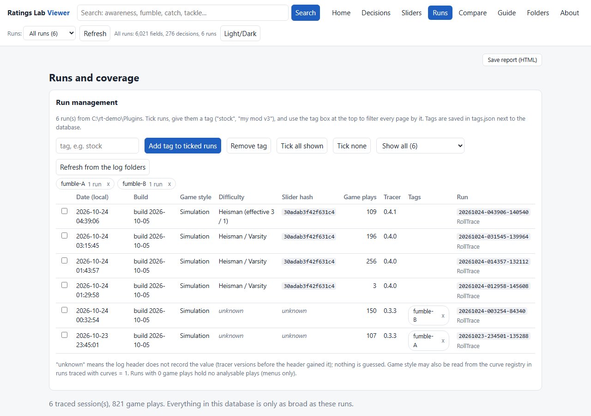
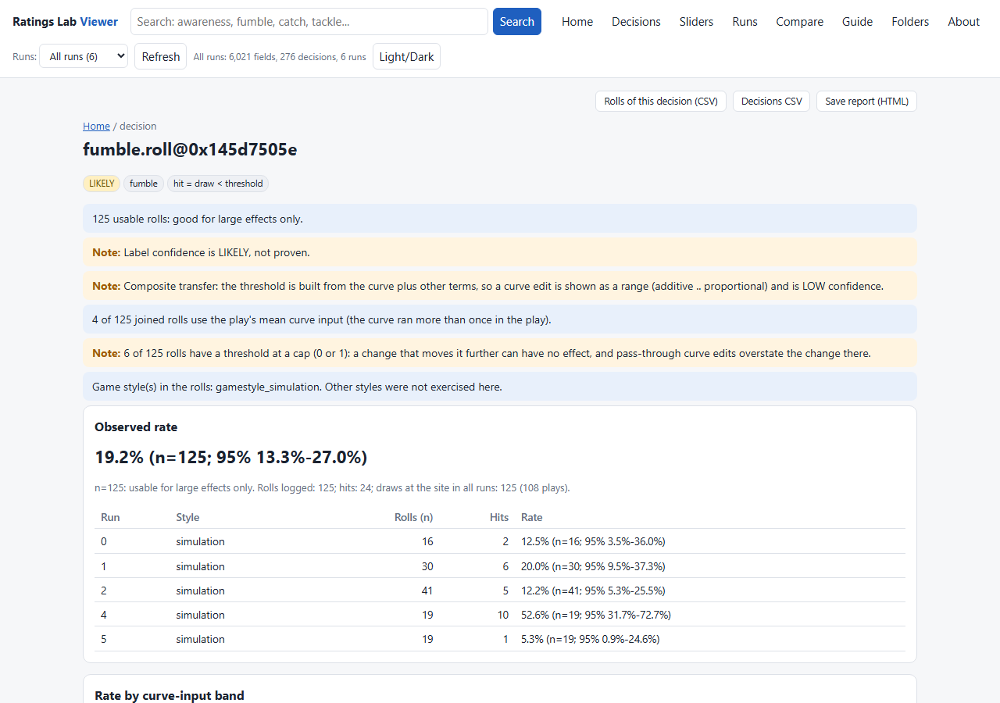
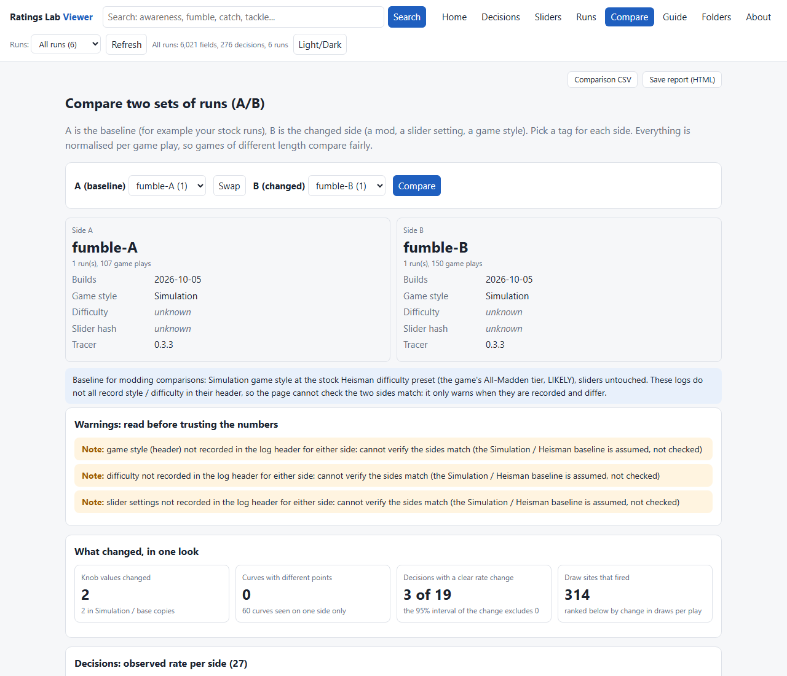

# Ratings Lab (pre-release 0.5.0)

**Download:** get `Ratings-Lab-0.5.0.zip` (and its `.sha256.txt`) from the [latest release](https://github.com/sdmart3/ratings-lab-releases/releases/latest). Source is not published here.

*Ratings Lab is the new name of Roll Tracer (0.4.x). It traces more than rolls: the random draws, the rating-to-chance curves, the
thresholds, and which ratings and sliders feed each outcome. The in-game plugin is the 0.4.1 build, unchanged, so its files, its log
names and the log folder keep the old names (`RollTracePlugin.dll`, `Plugins\RollTrace`, `rolltrace-*.jsonl`). Logs and installs from
0.4.x keep working as they are, and the first start copies an old `%APPDATA%\RollTracer` folder (tags, settings) to `%APPDATA%\RatingsLab`.*

**See which rolls, curves and ratings decide what happens in a College Football 27 game.**

Ratings Lab is for people who make or tune gameplay mods. While you play, a plugin logs the random rolls the game makes. A small
app on your PC turns those logs into pages you can search and read: which roll decided a catch, a fumble, a broken tackle, a
penalty, a pass-rush win; what number it was compared with; which tuning fields and curves feed that number; and what would have
happened if you had changed it.

It is log only. Every roll is handed back to the game unchanged, so the game plays as it does without the tool.

**Pre-release.** This build has run full games in the real game (see "Known limits" for what is and is not proven). Expect rough
edges and read "Known limits" below before you trust a number.





The screenshots show real logs. The A/B above is a real test: one game with the fumble chance multiplier raised tenfold. The
fumble roll's threshold mean rose from about 0.10 to 0.53 and its hit rate from 5.3% to 52.6% (19 rolls on each side, so read it as
proof the roll responds to the multiplier, not as a rate).

## What it does

- **Decisions**: every labelled roll (catch, drop, interception, fumble, tackle break, kick accuracy, penalties, block and pass-rush
  engagements and more) with how often it happens, how many rolls that is, a 95% interval, and where its threshold comes from.
- **Fields and curves**: every tuning field and curve in the game's tuning data, with its stock value per game style, the rating
  that feeds a curve, how the game was seen to use it, and an evidence level (see below).
- **What-if**: replay the logged rolls against a changed threshold, or a curve with one point moved, and see how many outcomes flip.
- **Target rate**: type the rate you want (for example fewer drops) and get the change that reaches it on your logged sample.
- **Stock vs mod**: tag runs "stock" and "my mod", then Compare: per-decision rate change with a 95% interval, which knob values
  really differ in the game, which curves moved, and warnings when the two sides are not a fair match.
- **Sliders**: what each gameplay slider is seen to scale.
- **Export**: any page as a one-file HTML report, and CSV for a spreadsheet.

## What is in this download

```
README.md                    this file
USER-GUIDE.md                a walkthrough: install, play, tag, compare, what-if, curves
CHANGELOG.md                 what changed
LICENSE, NOTICE              private use terms
Manual install\Plugins\      the plugin: copy everything in it into your Mod Manager's Plugins folder (over a 0.4.x install, same names)
Ratings Lab\                 the app and viewer (double-click ratings-lab.cmd; roll-tracer.cmd still works)
```

## Requirements

- College Football 27 (PC) on the game build this tool was made for (the mid-October 2026 update). On another build each part of
  the plugin logs "NOT installed" and stands aside; nothing is changed. Logs from different builds are not joined by address.
- The Mod Manager you already use to launch modded games.
- **Node.js 20 or newer** (free, from nodejs.org) for the app. The plugin itself needs nothing extra.
- A web browser. About 15 MB for the package, plus the logs (see Disk use).

## Install

1. Close the game and the Mod Manager.
2. Unzip the download anywhere.
3. Open `Manual install\Plugins`. Copy **everything in it** (`RollTracePlugin.dll` and the `RollTrace` folder) into your Mod
   Manager's `Plugins` folder, the one next to `MMCModManager.exe`. Make the `Plugins` folder if it is not there.
4. Start the Mod Manager (restart it if it was open: it reads plugins only at start) and launch the game from it as usual.
5. About 20 seconds after the game starts the plugin loads and begins logging. Check `Plugins\RollTrace\rolltrace.log`: it has one line
   per part, saying "installed" or "NOT installed" and why.

You end up with:

```
<Mod Manager>\Plugins\RollTracePlugin.dll
<Mod Manager>\Plugins\RollTrace\   rolltrace.dll, rolltrace.ini (settings), rolltrace-labels.tsv, plugin.cfg, README.txt, and the logs
```

Put `Ratings Lab\` anywhere you like (it does not have to be near the game).

## Uninstall

Close the game and the Mod Manager. Delete `Plugins\RollTracePlugin.dll` and the `Plugins\RollTrace` folder. To forget the app's
saved settings, tags and databases, delete `%APPDATA%\RatingsLab` (and `%APPDATA%\RollTracer` if you used 0.4.x). Nothing else was changed.

## How to run

Double-click `Ratings Lab\ratings-lab.cmd`. In one step it finds the plugin's log folder, reads the logs it has not seen, builds or
updates the analysis database, starts a private viewer on your own PC and opens it in your browser. Close its window to stop it.

If it cannot find the log folder, the viewer's **Folders** page has "Choose..." and "Check again". From a terminal:

```
ratings-lab                      the one-step start
ratings-lab where                which log folder it found, and how
ratings-lab refresh              read new logs and update the database, then print what it found
ratings-lab runs                 list the runs (date, build, style, difficulty, slider hash, tags)
ratings-lab tag stock 20261024   tag runs (part of an id or date, or "all" / "untagged" / "latest:3")
ratings-lab compare stock mine   the stock-vs-mod report in the terminal
ratings-lab export decisions --tag stock --out decisions.csv
ratings-lab serve --no-open      start the viewer without opening a browser
```

Options: `--logs <folder>` (use this log folder), `--extra <folder>` (also read a second folder), `--port <n>` (default 8765),
`--home <folder>` (where settings live), `--data <folder>` (where databases live), `--index <folder>` (a different field index).

## Where things go

| what | where |
|---|---|
| the logs | `<Mod Manager>\Plugins\RollTrace\rolltrace-<date>-<time>-<pid>.jsonl`, one file per game launch |
| the plugin's own notes | `Plugins\RollTrace\rolltrace.log` (and `.log.1`), `plugin.log` |
| research dumps | `Plugins\RollTrace\statelog-*.bin` / `.tsv` (one per launch) |
| the app's settings, tags, databases | `%APPDATA%\RatingsLab` |

## Disk use

- A full game writes roughly **22 to 54 MB** of log (about 108 plays gave 22 MB in testing); longer quarters mean more plays and more data.
  0.4.0 wrote about 128 MB for a game; 0.4.1 and later are much smaller.
- Safety limits (all editable in `rolltrace.ini`): a launch's log goes "light" (fewer line types) at 1 GB and stops 64 MB later; it
  also goes light when the disk has less than 1 GB free; at launch the oldest logs are deleted past 50 logs or 4 GB. Only Roll
  Tracer's own files are ever deleted.
- The analysis database in `%APPDATA%\RatingsLab` is smaller than the logs. Building takes about 3 seconds per 150 MB of logs.

## Evidence levels: the "never say unused" rule

Every field and curve carries one level that says **how we know** what it does.

| level | means |
|---|---|
| `LIVE_CURVE` | the curve was evaluated during a traced game (counts, callers and inputs are shown) |
| `LIVE_THRESHOLD` | the field is a knob of a labelled decision whose threshold was logged or worked out live |
| `STATIC_DECISION` | game code reads it and the value reaches a compare, clamp or curve (found by scanning the program, not seen live) |
| `STATIC_OTHER` | some code reads it; purpose unknown |
| `STATIC_SETUP` | only setup or copy code was found reading it; per-play use not traced |
| `NO_READER_FOUND` | no reader found in a family the scan covers. A lower bound only |
| `UNKNOWN` | outside what the scan covers, no live evidence. No claim either way |

**The tool never says a field is unused.** "No evidence" is not "unused": reads through held pointers and virtual calls are missed,
and a field can matter in a game style or situation you did not play. Do not edit a field because the tool found nothing on it.

Decision labels carry a confidence: **PROVEN** (read from the program or reproduced exactly), **LIKELY** (strongly implied),
**GUESS** (needs more data, do not rely on it).

## The default baseline

Everything defaults to the **Simulation** game style at the stock **Heisman** difficulty with the sliders untouched. Use the same
baseline for the games you compare, so your numbers are comparable between your own runs and with other people's.

- Field pages show the Simulation copy of a value (or the base copy, which Simulation reads when it has none of its own). Other styles
  sit behind a toggle. A mod edit that exists only in another style's copy is flagged "does not reach Simulation".
- The game style and slider settings are read from the running game and written in every log header. Difficulty is logged as your setting
  plus each team's effective value (for example "Heisman (effective 3 / 1)": you chose Heisman, and the two teams' gameplay code reads 3 and 1).
  Heisman as the top tier is **LIKELY**, not proven, and which effective value belongs to which team is not confirmed. Anything not recorded shows as
  "unknown", never guessed.

## Known limits

- **Pre-release.** The game plugin is the 0.4.1 build, which ran full games in the real game; 0.5.0 renames the app and the plugin's
  display name only (the plugin loader was rebuilt and passed its offline test, not yet a run in the game). 0.4.0 and 0.4.1 each ran full games with no crash and no dropped
  draws. Several full games on one setup are still to come, so numbers from single games are hints.
- **Not every decision has one roll.** Each label is PROVEN, LIKELY or GUESS, and the viewer shows which.
  - Strongest: catch resolution, interceptions, kick accuracy, and the penalty rolls whose thresholds the game itself logs.
  - Proven in the game: the fumble roll. Multiplying the fumble chance by 10 moved its threshold mean from 0.104 to 0.533 and its hit
    rate from 5.3% to 52.6%. (The label table inside this build still says LIKELY; the viewer shows that word.)
  - Likely: the tackle pre-roll and pass-rush win rolls.
  - Weakest: some labelled draws have no readable threshold, and a few sites have never fired in testing.
- **Physics-driven results have no single roll.** Broken tackles, sacks and pressure come out of an engagement that compares a
  chance with a pre-rolled value, plus gates and animation state. Ratings Lab logs the parts it can find; it does not claim one dice
  roll "is" a sack. Yards after contact, tackling animations and hit reactions are physics, not rolls.
- **Curves are mostly combined.** A decision's threshold is usually several curves and ratings multiplied together, so a curve edit is
  shown as a range with LOW confidence unless the threshold is exactly that curve's output.
- **Samples are small.** One game is a few thousand plays at most and some decisions fire a handful of times. Every rate shows its n
  and a 95% interval; rows with fewer than 10 usable rolls are marked "anecdotal".
- **No per-field "was it read" tracing.** Reads of individual fields are not watched live. Field evidence comes from the curve log,
  the roll thresholds, and a static scan of the game.
- **Not covered:** the separate Super Sim engine that dynasty mode uses for games nobody plays.
- The plugin is tied to the game build. A game update can move the code it looks for; it then stands aside until the tool is updated.

## Troubleshooting

- **No logs appear.** Close the game and the Mod Manager, check that `RollTracePlugin.dll` sits directly in `Plugins` with the
  `RollTrace` folder beside it, restart the Mod Manager (it only loads plugins at start), then launch from the Mod Manager. Wait 20
  seconds after the game window shows. `Plugins\RollTrace\plugin.log` and `rolltrace.log` say what happened. Antivirus can
  quarantine plugin DLLs; if `RollTracePlugin.dll` is gone, restore it and add an exclusion for the Plugins folder.
- **"NOT installed" lines in rolltrace.log.** The game build differs from the one the plugin knows. The game plays normally; wait for
  an update of the tool.
- **The app says Node.js was not found.** Install Node.js 20 or newer from nodejs.org and run `ratings-lab.cmd` again.
- **The app cannot find the log folder.** Open **Folders** in the viewer and choose it (it is `Plugins\RollTrace` inside your Mod
  Manager folder), or run `ratings-lab --logs "<folder>"`.
- **The page says "unknown" for style, difficulty or sliders.** The log came from an older plugin build, or the game was still
  loading when it was written. Play again with 0.4.0 or newer. (Logs from 0.4.0 on carry the style, difficulty and sliders on the first game line; the app reads them from there.)
- **Compare is empty or warns.** Read the warnings first: they say what differs between your two sets of games (build, style,
  difficulty, sliders).
- **Port busy.** Ratings Lab uses the next free port when 8765 is taken; the address is printed in its window.
- **A log is huge or the game feels slower.** Lower `max_session_mb` in `rolltrace.ini`, or set `curves = 0` to stop the curve log,
  the heaviest part.

## Privacy

Everything stays on your PC. The plugin writes logs to your Mod Manager's Plugins folder. The app reads them, writes its database to
`%APPDATA%\RatingsLab`, and serves the viewer on 127.0.0.1 (your own machine only). The viewer loads no fonts, scripts or images from
the internet, and neither the plugin nor the app makes any network connection or sends anything anywhere. Logs contain the game's
own data (player ids, ratings, play results), not your account details.

## Use it at your own risk

The plugin patches the game's code in memory to read its rolls, like other Mod Manager plugins. Use it for offline play and testing
only, never in online modes. See LICENSE: private use, no redistribution or sale, no warranty.
